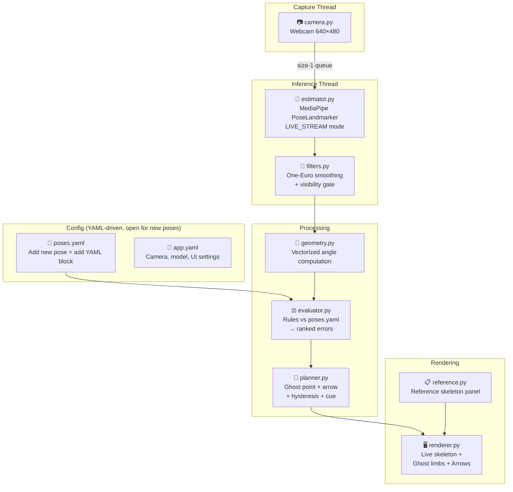

# Yoga Pose Detection & Correction — Development Plan (v2)

> **Course:** CSIT334 HCI · **Window:** Oct 27 – Nov 30, 2026  
> **Goal:** Real-time webcam app that detects yoga poses and shows **ghost limbs + directional arrows** to visually guide the user from their current pose to the correct pose.

> [!IMPORTANT]
> **Scope clarifications (v2):**
> - ❌ No grading / scoring system — **correction only** (arrows from actual → target)
> - ❌ Surya Namaskar deferred to future — no dataset, no FSM for now
> - ✅ Architecture must be **open for new poses** — add a YAML block + reference data = new pose works
> - ✅ ViTPose evaluated and **rejected** (see §1 below)

---

## 1. ViTPose Evaluation — Why NOT to Use It

I thoroughly reviewed the [ViTPose repo](file:///c:/Yoga_F/ViTPose) you have. Here's the honest assessment:

### What ViTPose is
A **state-of-the-art 2D keypoint detector** (NeurIPS 2022) based on Vision Transformers. It achieves 81.1 AP on COCO — significantly more accurate than MediaPipe for **2D keypoint localisation** on benchmark datasets.

### Why it does NOT fit our project

| Factor | ViTPose | MediaPipe | Verdict |
|--------|---------|-----------|---------|
| **GPU required** | ✅ **Needs CUDA GPU** (`--device cuda:0`) — your machine has **no GPU** | ❌ CPU-only, runs fine | 🚫 **Dealbreaker** |
| **Dependencies** | `mmcv-full`, `mmdet`, `mmtrack`, `PyTorch`, `torchvision` — huge stack, fragile builds | Single pip package | MediaPipe wins |
| **3D world coords** | ❌ Only gives 2D (x,y) keypoints — **no depth** | ✅ 33 landmarks with **world 3D coordinates** (metres) | MediaPipe wins — we need 3D for `rotate_limb()` |
| **Real-time speed** | ~15 FPS on GPU (ViTPose-S), **<2 FPS on CPU** | 25–30 FPS on CPU | MediaPipe wins |
| **Tracking mode** | ❌ No tracking — re-detects every frame (needs person detector too) | ✅ LIVE_STREAM mode tracks from previous frame | MediaPipe wins |
| **17 vs 33 keypoints** | 17 COCO keypoints (no fingers, no heels, no foot index) | 33 landmarks including hands, heels, foot tips | MediaPipe wins for yoga |
| **Person detector** | Needs separate MMDetection model first (two-stage) | Built-in detection | MediaPipe simpler |
| **2D accuracy** | Higher 2D precision on benchmarks | Good enough for yoga (we compare *angles*, not pixel positions) | Doesn't matter for us |

> [!CAUTION]
> **Bottom line: ViTPose is a research powerhouse for 2D keypoint benchmarks, but it's the wrong tool for our project.** We need:
> 1. **3D world coordinates** → only MediaPipe gives this from a single webcam
> 2. **CPU real-time** → your machine has no GPU
> 3. **Tracking mode** → MediaPipe LIVE_STREAM gives this for free
> 4. **Simple setup** → ViTPose's mmcv/mmdet/mmtrack stack is notoriously painful to install
>
> The 2D accuracy advantage doesn't help us because our correction system works on **joint angles** (computed from 3 points), not raw pixel positions. A few pixels of jitter in keypoint location barely affects the computed angle — our One-Euro filter handles the rest.

### When would ViTPose make sense?
- If we had a **CUDA GPU** and needed **pixel-perfect 2D keypoints** (e.g., for sports biomechanics video analysis, not real-time)
- If we were doing **pose classification** with a CNN where keypoint accuracy is the bottleneck
- Never for a real-time correction system on CPU

**Decision: Stick with MediaPipe PoseLandmarker. ViTPose is out.**

---

## 2. Reference Project Audit — What We Take, What We Drop

### 2.1 Aligned Yoga App ([modeling.py](file:///c:/Yoga_F/Aligned_Yoga_App/code/aligned/modeling.py))

| What we take | What we drop |
|---|---|
| ✅ **Rule architecture**: Per-pose functions that check body attributes → generalise into YAML-driven `evaluator.py` | ❌ OpenPose → MediaPipe |
| ✅ **Still-frame extraction** (`mean_ten_still_frames`): Stable frame detection → reuse in `calibration.py` | ❌ Flask web app, S3, user auth |
| ✅ **Correction check patterns**: `hips_square()`, `straight_torso()`, `front_knee_obtuse()` — logic patterns we adapt to angle-based rules | ❌ Slope-based checks → proper 3D vector angles |
| | ❌ **Grading system** (`ProcessLabel.to_text()`) — user said no grading |

### 2.2 Yoga Poses Dataset ([Yoga_Poses-Dataset](file:///c:/Yoga_F/Yoga_Poses-Dataset))

| What we take | What we fix |
|---|---|
| ✅ **Triangle pose raw landmarks** (60 images × 33 joints × x,y,z,vis) → compute target angle ranges | ⚠️ Pre-computed angles are 0–360° (`atan2`) — must recompute as 0–180° (`arccos`) |
| ✅ **Downward Dog / Veerabhadrasana landmarks** — usable for future pose expansion | ⚠️ No Cobra or Bow data — record our own |
| ✅ **MediaPipe landmark extraction pattern** from [main.py](file:///c:/Yoga_F/Yoga_Poses-Dataset/main.py) | |

### 2.3 YogaPoseCorrector ([mainFile.py](file:///c:/Yoga_F/YogaPoseCorrector/mainFile.py))

| What we take | What we drop |
|---|---|
| ✅ **Correction flow**: Reference angles → compute user angles → compare → display correction | ❌ tf-pose-estimation → MediaPipe |
| ✅ **Multi-pose selection** menu pattern | ❌ Simple "more"/"less" text → ghost limbs + arrows |
| ✅ **Per-joint tolerance concept** (we make it configurable per rule) | ❌ Fixed ±13° for all joints |

---

## 3. Architecture



### Open-for-extension design

Adding a new pose requires **only two things**:
1. **Add a YAML block** in `poses.yaml` with joints, targets, tolerances, and cue text
2. **Add reference keyframes** (optional, for the reference panel)

No code changes needed. The evaluator, planner, and renderer are all generic.

---

## 4. The Correction Module — How It Works

> [!NOTE]
> **No grading. No scoring.** The system shows **what's wrong** and **how to fix it** — that's it.

### 4.1 Correction pipeline (step by step)

```
User's right elbow is at 45°, target is 90°

1. DETECT  (estimator.py)
   → MediaPipe gives 33 landmarks (image coords + world 3D coords)
   → One-Euro filter smooths jitter

2. EVALUATE  (evaluator.py)
   → Rule from poses.yaml:
     {name: "right_elbow_bend", joints: [right_shoulder, right_elbow, right_wrist],
      target: 90, tol: 8, cue_low: "Bend your right elbow more"}
   → Measured: angle_deg(shoulder, elbow, wrist) = 45°
   → Error: |90 - 45| = 45° > tol(8°) → FAILING
   → Rank by (weight × error / tolerance) → prioritise worst errors

3. PLAN  (planner.py)
   → Hysteresis: error persisted > 5 frames → show correction
   → Ghost: rotate_limb(shoulder, elbow, wrist, target=90°)
     → Returns wrist_ghost at 90° angle, preserving forearm length
   → Project world→screen: wrist_ghost_px
   → Build Correction object: arrow from wrist_px → wrist_ghost_px

4. RENDER  (renderer.py)
   → Draw user's live skeleton (blue)
   → Draw ghost limb: green dashed line (elbow → wrist_ghost)
   → Draw arrow: orange arrow (wrist_current → wrist_ghost)
   → Label: "45° → 90°" near arrow
   → Text cue: "Bend your right elbow more" at bottom
   → When ALL rules pass: show "✓ Pose Aligned!" (no score, just pass/fail)
```

### 4.2 Visual example of what the user sees

```
    ┌──────────────────────────────────────────────┐
    │                                              │
    │        User's live skeleton (blue)           │
    │                                              │
    │              O  ← head                       │
    │             /|\                               │
    │            / | \                              │
    │     ------   |   \  ← current arm (45°)      │
    │              |    \                           │
    │              |     · · · · →  ghost arm (90°) │
    │              |         ↗                      │
    │             / \   "45° → 90°"                │
    │            /   \                              │
    │           /     \                             │
    │                                              │
    │  "Bend your right elbow more"                │
    │                                              │
    ├──────────────────────────────────────────────┤
    │  [Triangle ▼]    FPS: 28    Aligned: ✗      │
    └──────────────────────────────────────────────┘
```

---

## 5. Folder Structure

```
c:\Yoga_F\src\
├── yogacorrect/
│   ├── __init__.py
│   ├── main.py                 # entry point, event loop, pose selection
│   ├── types.py                # Landmarks, Rule, Error, Correction dataclasses
│   ├── camera.py               # threaded capture, latest-frame-only
│   ├── estimator.py            # MediaPipe PoseLandmarker wrapper
│   ├── filters.py              # One-Euro filter + visibility gate
│   ├── geometry.py             # angle_deg, rotate_limb, batch angles
│   ├── calibration.py          # neutral-stance bone lengths
│   ├── evaluator.py            # YAML rules → errors, ranking
│   ├── planner.py              # ghost point, arrow, cue, hysteresis
│   ├── renderer.py             # OpenCV UI: skeleton + ghost + arrows
│   ├── reference.py            # reference skeleton panel (scaled to user)
│   ├── session.py              # state: selected pose, mode, timers
│   └── perf.py                 # per-stage timing, p50/p95
├── configs/
│   ├── poses.yaml              # per-pose rules (EXTENSIBLE — add block = new pose)
│   └── app.yaml                # camera, model, UI settings
├── models/
│   └── pose_landmarker_lite.task
├── assets/
│   └── reference_keyframes/    # reference skeletons per pose (json)
├── data/
│   └── raw/                    # Yoga_Poses-Dataset landmark CSVs
├── tools/
│   ├── build_refs.py           # dataset CSVs → poses.yaml target ranges
│   ├── record_session.py       # record landmarks for new poses
│   └── replay.py               # replay recorded sessions for testing
├── tests/
│   ├── test_geometry.py
│   ├── test_filters.py
│   ├── test_evaluator.py
│   └── test_planner.py
├── requirements.txt
├── pyproject.toml
└── README.md
```

---

## 6. Development Phases

### Phase 1 — Vertical Slice (Oct 27–28) ⬅ START HERE

> Get ONE pose (Triangle) with ONE correction arrow working end-to-end.

| # | Module | File | What to build |
|---|--------|------|---------------|
| 1 | Types | `types.py` | `Landmarks`, `Rule`, `Error`, `Correction` dataclasses |
| 2 | Geometry | `geometry.py` | `angle_deg()`, `rotate_limb()`, vectorized batch angles |
| 3 | Tests | `test_geometry.py` | Known angles, collinear, zero-length, rotate_limb output |
| 4 | Camera | `camera.py` | Threaded webcam, size-1 queue, 640×480, MJPG |
| 5 | Estimator | `estimator.py` | MediaPipe LIVE_STREAM wrapper (33 landmarks + world coords) |
| 6 | Config | `poses.yaml` | Triangle rules (front_knee, arms, torso) with initial targets |
| 7 | Evaluator | `evaluator.py` | Load YAML rules, compute angles, rank errors |
| 8 | Planner | `planner.py` | Ghost point via `rotate_limb()`, arrow, text cue |
| 9 | Renderer | `renderer.py` | Single-panel: live skeleton + ghost limb + arrow + label |
| 10 | Main | `main.py` | Wire all modules, event loop, pose selection |

### Phase 2 — Stability & Multi-Pose (Oct 29 – Nov 3)

| Module | What to build |
|--------|---------------|
| **Filters** | One-Euro smoothing on landmarks + ghost endpoints, visibility gate |
| **Planner v2** | Hysteresis (5-frame enter, 8-frame exit), dead zone |
| **Calibration** | Neutral-stance bone lengths (3s hold) for ghost scaling |
| **Multi-pose** | Add Cobra + Bow rules to `poses.yaml`, record reference frames |
| **Tests** | Evaluator thresholds, planner hysteresis, filter convergence |
| **build_refs.py** | Process Triangle dataset CSVs → auto-generate target ranges |

### Phase 3 — Full UI & Polish (Nov 4–10)

| Module | What to build |
|--------|---------------|
| **Renderer v2** | Two-panel: live view + animated reference skeleton |
| **Reference** | Bezier-interpolated reference skeleton, scaled to user's bone lengths |
| **Session** | Pose selection UI, "aligned" detection (all rules pass for N seconds) |
| **Perf** | Timing per stage, FPS counter, p50/p95 logging |
| **New poses** | Test adding a new pose via YAML-only (prove extensibility) |

### Phase 4 — Testing & Documentation (Nov 11–18)

| Deliverable | What |
|---|---|
| Record/replay | `record_session.py` + `replay.py` for deterministic testing |
| Scenario tests | Correct pose, wrong arm, wrong leg, multiple errors, occlusion |
| Latency report | Measured per-stage timings vs targets |
| Documentation | `pose_specs.md` per pose, `README.md` with setup guide |

### Phase 5 — User Study & Submission (Nov 19–30)

| Deliverable | What |
|---|---|
| User testing | 10–12 novices, time-to-correction, structured feedback |
| Report | Analysis, limitations, demo video |

> [!TIP]
> **Surya Namaskar** is explicitly out of scope for now. The architecture supports it — when ready, add `surya_fsm.py` + `surya.yaml` without changing any existing code.

---

## 7. How New Poses Are Added (Extensible Design)

Just add a block to `poses.yaml`:

```yaml
# Example: adding Warrior II in the future
warrior2:
  view: front
  min_visibility: 0.6
  rules:
    - name: front_knee_bent
      kind: angle
      joints: [right_hip, right_knee, right_ankle]
      target: 90
      tol: 10
      weight: 1.0
      safety: true
      cue_low: "Bend your front knee deeper"
      cue_high: "Don't overbend your front knee"
    - name: arms_straight
      kind: angle
      joints: [left_wrist, left_shoulder, right_shoulder]
      target: 180
      tol: 10
      weight: 0.8
      cue_low: "Straighten your arms"
```

That's it. No code changes. The evaluator reads all poses, the planner generates corrections, the renderer draws them.

---

## 8. Key Design Decisions

| Decision | Choice | Why |
|----------|--------|-----|
| Pose estimator | **MediaPipe PoseLandmarker** (lite model) | 3D world coords, CPU real-time, tracking mode, 33 landmarks — ViTPose rejected (no GPU, no 3D, massive deps) |
| Correction display | **Ghost limbs + directional arrows** | Core innovation — visual "move HERE" guidance, not text-only |
| No grading | Just correction arrows + "Aligned ✓" | User requirement — keep it simple and actionable |
| Rule storage | **YAML files** | Extensible — new pose = new YAML block, zero code changes |
| Angle convention | Unsigned 0–180° via `arccos(dot)` | Avoids bugs from `atan2` (0–360°) in reference projects |
| Smoothing | One-Euro filter | Jitter reduction without lag |
| Stability | Hysteresis (5-frame enter, 8-frame exit) | Prevents arrow flickering |
| Threading | 3 threads (capture/inference/render) | Low latency, never stale data |

---

## 9. Dependencies

```txt
mediapipe>=0.10.14
opencv-python>=4.8.0
numpy>=1.24.0
pyyaml>=6.0
pytest>=7.4.0

# tools only:
pandas>=2.0.0
```

---

## 10. Risks and Mitigations

| Risk | Mitigation |
|------|------------|
| No Cobra/Bow in dataset | Record our own reference frames (10+ images each) |
| Side-view poses have unreliable depth | Use world landmarks for 3D, state limitation, 2D fallback |
| Arrow jitter | One-Euro on ghost endpoints + hysteresis |
| Dataset angles are 0–360° | Recompute from raw landmarks using `angle_deg()` |
| Deadline pressure | Phase 1 vertical slice first; later phases can be trimmed |

---

**Ready to proceed? Approve this plan and we start coding Phase 1 immediately.**
